# Come usare il workflow agentico di MindCompanion

**Destinatari** · PM, sviluppatori e revisori del team C08\
**Configurazione verificata** · 20 novembre 2026, branch `main`, commit `50c6912`

Il workflow trasforma un caso d’uso documentato in una pull request verificabile. Claude Code propone il piano, implementa le modifiche dopo il via libera, scrive i test in una sessione separata e confronta la PR con le specifiche. Il team decide quando far avanzare il task, verifica il codice e approva il merge. GitHub Actions esegue le fasi e GitHub Projects ne mostra l’avanzamento.

[Repository MindCompanion](https://github.com/unisa-gps-team08/MindCompanion) · [GitHub Actions](https://github.com/unisa-gps-team08/MindCompanion/actions) · [Board del team](https://github.com/orgs/unisa-gps-team08/projects/1/views/1)

## Il percorso di un task

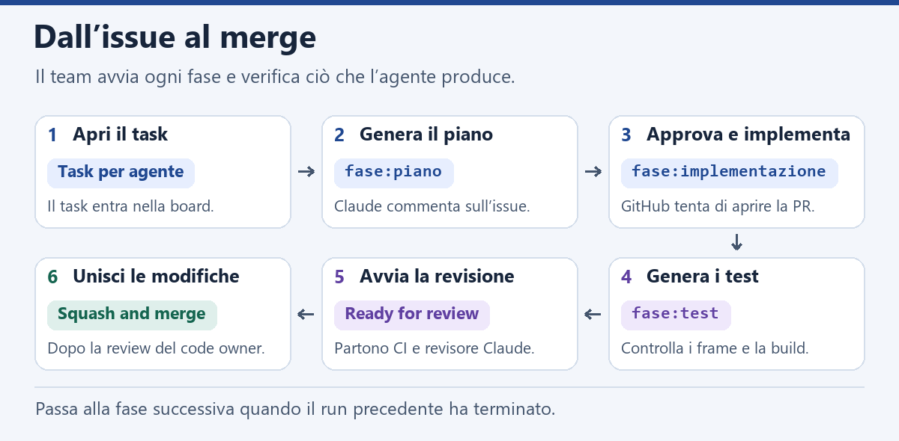

| Azione del team | Dove | Risultato dell’automazione |
| --- | --- | --- |
| Apri **Task per agente** | Issues | Il modulo applica `task-agente` e la board acquisisce l’issue. |
| Applica `fase:piano` | Issue | Il pianificatore pubblica il piano come commento. |
| Applica `fase:implementazione` dopo la verifica del piano | Issue | GitHub verifica la build, pubblica `agent/issue-N` e tenta di aprire la PR in bozza. |
| Applica `fase:test` | PR in bozza | Il tester aggiunge nuovi file di test. GitHub li esegue e pubblica l’esito sulla PR. |
| Seleziona **Ready for review** | PR | Partono CI e revisione. Claude pubblica le osservazioni sul commit esaminato. |
| Approva e fai **Squash and merge** | PR | GitHub integra il codice e chiude l’issue collegata da `Closes #N`. |

Il PM prepara il task e avvia il piano. Lo sviluppatore lo controlla prima di autorizzare l’implementazione e accompagna la PR fino alla review. Un code owner rivede il risultato e approva. Serve accesso **Write** o superiore per avviare le fasi. Attendi l’esito di ogni run prima di avviare il successivo.

## 1. Prepara il primo task reale

Prima di iniziare, porta su `main` con una PR del team:

- Il codice e le dipendenze del progetto.
- Il caso d’uso approvato e i modelli pertinenti in `docs/`. Scegli i diagrammi che descrivono i comportamenti e le interfacce interessate dal task.
- Le firme pubbliche e i test frame, con identificativo, condizioni ed esito atteso. Includi il flusso principale, i casi limite e gli errori osservabili.
- Lo script Bash `.github/scripts/verify-project`. Viene eseguito dalla radice della repo e deve contenere i comandi effettivi per installare le dipendenze, compilare, svolgere i controlli previsti dal team ed eseguire i test. Deve restituire un codice di uscita diverso da zero quando un controllo fallisce.

Puoi provare lo stesso script in locale dalla radice della repo in una shell Bash.

```bash
bash .github/scripts/verify-project
```

La CI invoca questo script quando è presente. Finché manca, il check `build` di una PR ordinaria può risultare verde dopo i soli controlli di configurazione. Le fasi applicative e le PR sui branch `agent/issue-*` richiedono lo script.

## 2. Apri l’issue con il modulo

Da **Issues → New issue**, seleziona **Task per agente** e compila tutti i campi. Mantieni i titoli generati dal modulo. Il workflow li usa per individuare i dati del task. [Apri un nuovo task per agente](https://github.com/unisa-gps-team08/MindCompanion/issues/new?template=task-agente.yml).

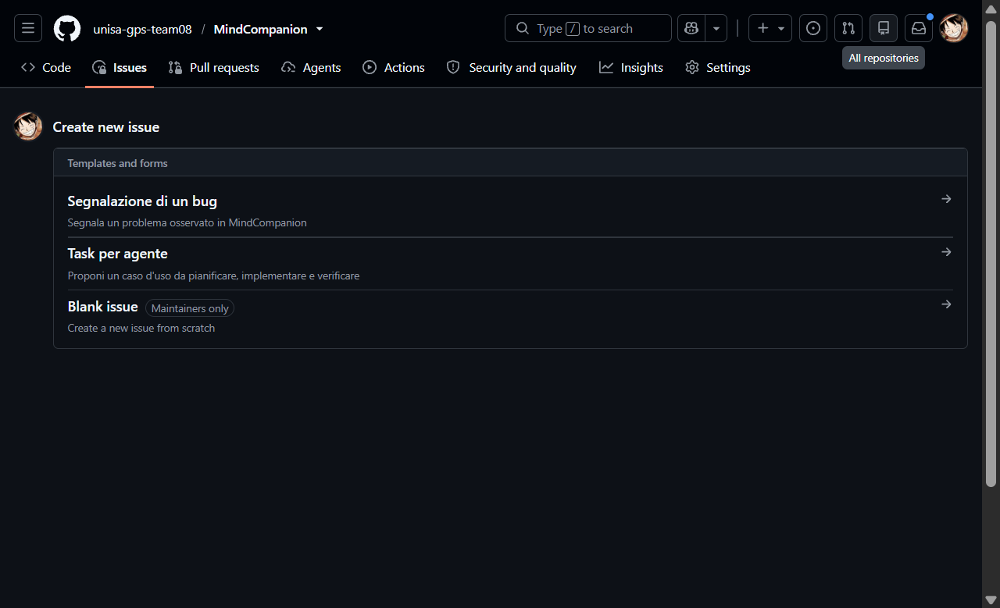

*Selezione del modulo in MindCompanion.* Clicca sulla riga **Task per agente**. Dopo aver compilato tutti i campi obbligatori, clicca sul pulsante verde **Create** e verifica che l’issue abbia la label `task-agente`.

<details>
<summary>Mostra il modulo reale con il pulsante Create</summary>

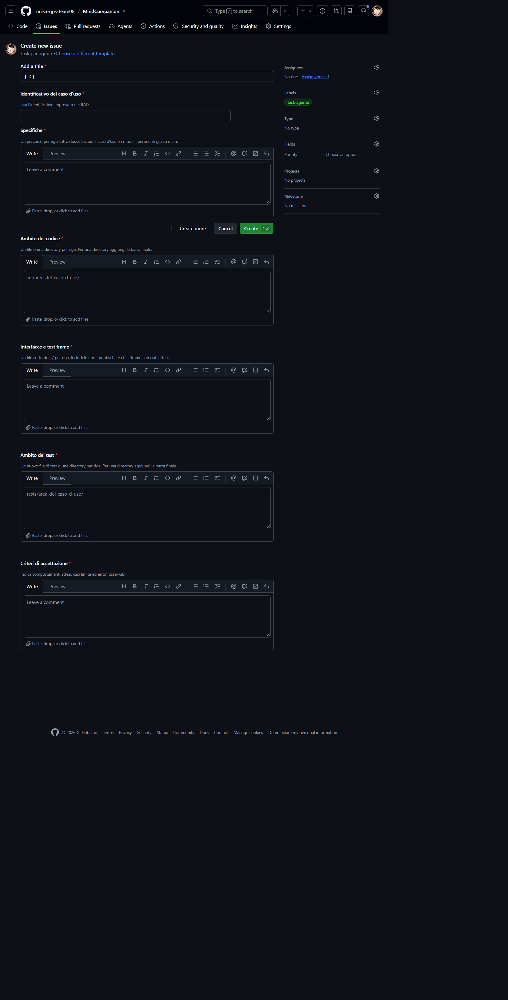

</details>

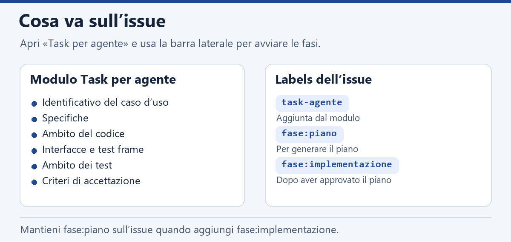

| Campo | Cosa inserire | Esempio illustrativo |
| --- | --- | --- |
| **Identificativo del caso d’uso** | ID approvato nel RAD e nome breve | `UC-07 Preferenze di visualizzazione` |
| **Specifiche** | Percorsi ai requisiti e ai modelli già versionati su `main` | `docs/rad/uc-07.md` e `docs/sdd/uc-07-sequenza.puml` su righe distinte |
| **Ambito del codice** | File o directory in cui l’implementatore può intervenire | `src/preferenze/` |
| **Interfacce e test frame** | File con firme, input, condizioni ed esiti attesi | `docs/test/uc-07-frame.md` |
| **Ambito dei test** | Percorsi in cui il tester può creare nuovi file | `tests/preferenze/` |
| **Criteri di accettazione** | Risultato verificabile, casi limite ed errori | Una preferenza valida viene salvata, un valore sconosciuto lascia la preferenza precedente. |

Usa percorsi relativi alla radice, uno per riga, senza spazi. Aggiungi `/` alla fine delle directory. Per **Specifiche** e **Interfacce e test frame** usa file `.md`, `.puml`, `.mmd` o `.txt` già presenti sotto `docs/`. Gli esempi nella tabella mostrano il formato. Sostituiscili con i percorsi effettivi del caso d’uso.

Tieni separati l’ambito del codice e quello dei test. Il team gestisce le modifiche a workflow, manifest delle dipendenze, configurazione degli agenti e modelli con le proprie PR. Usa dati fittizi nei test e negli esempi dell’issue.

## 3. Genera il piano e autorizza l’implementazione

1. Nella barra laterale dell’issue, clicca sull’ingranaggio accanto a **Labels**. In **Filter labels** cerca e seleziona `fase:piano`. In **Actions → Agente pianificatore** puoi seguire il run.
2. Leggi il commento pubblicato sull’issue. Verifica i file e le firme coinvolti, il perimetro del task, i test frame da coprire e le eventuali decisioni mancanti. Il piano si riferisce al contenuto dell’issue e a un commit preciso di `main`.
3. Se servono correzioni, aggiorna l’issue o integra prima le specifiche approvate su `main`. Rimuovi e riapplica `fase:piano` per generare un piano aggiornato. Fai lo stesso se `main` è avanzato prima di autorizzare l’implementazione.
4. Quando il piano è approvato, mantieni `fase:piano` e aggiungi `fase:implementazione` **alla stessa issue**. L’applicazione di questa label è il via libera registrato dal workflow. Un commento di approvazione da solo lascia la fase in attesa.
5. Apri **Actions → Agente implementatore**. Dopo la verifica preliminare, cerca il branch `agent/issue-N` e la PR in bozza. `N` è il numero dell’issue. La descrizione riporta il caso d’uso, gli artefatti, il link al piano, chi ha autorizzato la fase e `Closes #N`.

Se GitHub blocca la creazione automatica della PR, cerca **Apri la PR in bozza** nel riepilogo del run. Usa `main` come base e `agent/issue-N` come branch di confronto. Seleziona **Create draft pull request** e aggiungi `Closes #N` alla descrizione. Conserva il branch già pubblicato e prosegui dalla PR.

### Dove cliccare per le label e i log

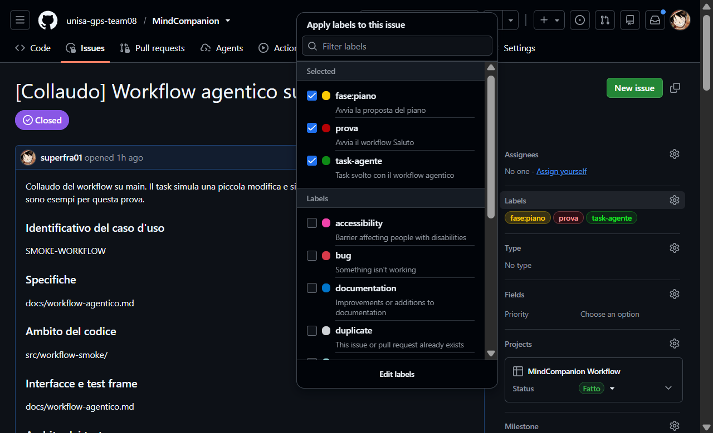

*Menu **Labels** nell’issue di collaudo.* Clicca sull’ingranaggio a destra di **Labels**, poi clicca sulla casella della label da aggiungere. L’issue mostrata è il collaudo già chiuso. Esegui i passaggi sul tuo task aperto. [Apri l’issue di collaudo](https://github.com/unisa-gps-team08/MindCompanion/issues/2).

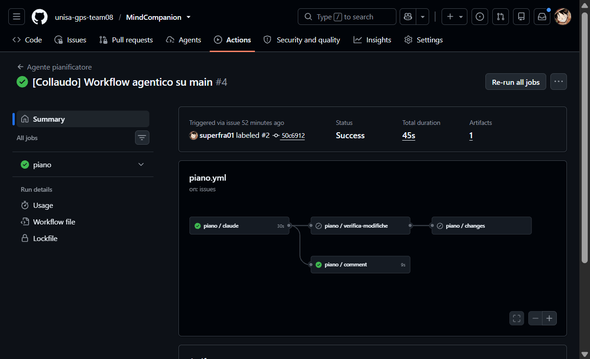

*Riepilogo del run del pianificatore.* In **Actions**, scegli il workflow e apri il run dell’issue. Clicca su un riquadro nel grafico o su un job sotto **All jobs** per aprire i log. **piano / comment** pubblica il piano sull’issue. [Apri questo run](https://github.com/unisa-gps-team08/MindCompanion/actions/runs/44728627075).

## 4. Genera ed esegui i test

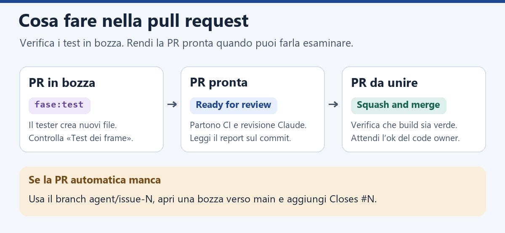

1. Con la **PR ancora in bozza**, apri **Conversation**. Clicca sull’ingranaggio di **Labels** a destra e seleziona `fase:test`, usando lo stesso menu mostrato per l’issue.
2. Il tester lavora con caso d’uso, firme pubbliche e test frame del riferimento approvato. La sessione è isolata dal branch dell’implementazione. Produce nuovi file entro l’ambito dei test e associa almeno un test a ogni frame.
3. Un job separato applica i nuovi test al codice della PR ed esegue `verify-project`. Cerca il commit dei test e il commento **Test dei frame**, che include il link ai log e l’esito.
4. Controlla che ogni frame abbia un test con l’esito atteso corretto. Se la suite applicativa fallisce, il workflow può pubblicare comunque i test per consentire la diagnosi. Prima della review, correggi il problema sul branch e riesegui la verifica. Se i test sono già stati pubblicati, evita di rigenerare gli stessi file.

## 5. Rivedi la PR e fai il merge

- Quando i test sono verificati, vai in fondo a **Conversation** e seleziona **Ready for review**. Il gesto avvia sia la CI sia **Agente revisore**. È particolarmente importante per una PR aperta da GitHub Actions, per la quale l’evento iniziale può lasciare la CI in attesa.
- Nel commento del revisore controlla il commit esaminato. Claude confronta il diff con i flussi, le interfacce, i diagrammi pertinenti e la copertura dei test frame. Se la PR è stata aperta a mano, indica nella descrizione il caso d’uso e i riferimenti in `docs/`.
- Completa la descrizione con esito dei test, frame coperti, tentativi, eventuali modifiche ai modelli e revisore umano. Chi presenta la PR deve saper spiegare le modifiche.
- Attendi il check `build`, risolvi le conversazioni e ottieni l’approvazione di un code owner secondo `protect-main`. Quando GitHub abilita il merge standard, usa **Squash and merge**.
- Se dopo una correzione serve un nuovo commento di Claude, riporta la PR in bozza e poi seleziona di nuovo **Ready for review**. Un nuovo push può far ripartire la CI. La review Claude usa il passaggio a **Ready for review**.

[Regole di protezione](https://github.com/unisa-gps-team08/MindCompanion/rules) · [Code owner](https://github.com/unisa-gps-team08/MindCompanion/blob/main/.github/CODEOWNERS) · [Template PR](https://github.com/unisa-gps-team08/MindCompanion/blob/main/.github/pull_request_template.md)

### I pulsanti in GitHub

1. **Autore della PR.** In fondo a **Conversation**, clicca su **Ready for review**.

   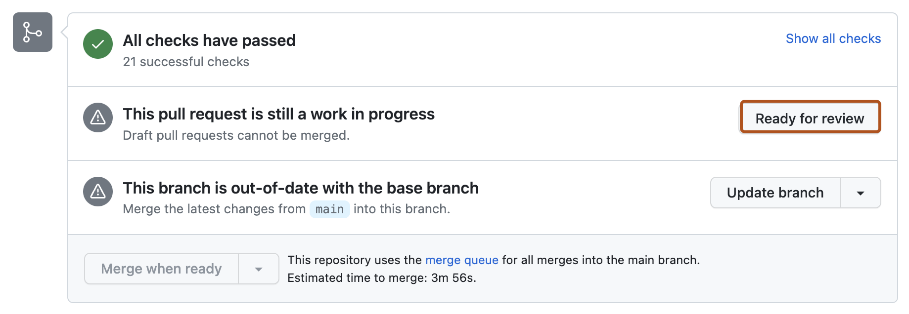

   [GitHub Docs · Passare dalla bozza alla revisione](https://docs.github.com/en/pull-requests/how-tos/create-pull-requests/changing-the-stage-of-a-pull-request)

2. **Revisore.** Apri **Files changed** e leggi il diff. Clicca sul pulsante verde sopra il diff, chiamato **Submit review** nella vista di MindCompanion e **Review changes** nell’esempio di GitHub Docs. Nel pannello **Finish your review**, seleziona **Approve** e clicca su **Submit review** per inviare l’approvazione.

   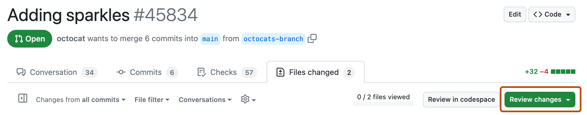

   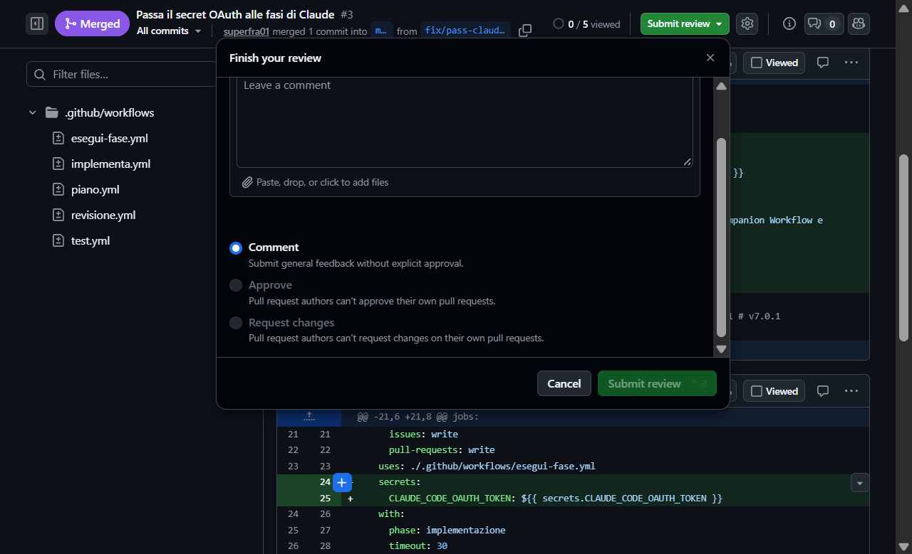

   *Vista dell’autore della PR.* GitHub mostra **Approve** disabilitato perché l’autore non può approvare la propria PR. Il code owner apre lo stesso pannello dal proprio account.

   [GitHub Docs · Inviare una revisione](https://docs.github.com/en/pull-requests/how-tos/review-pull-requests/reviewing-proposed-changes-in-a-pull-request)

3. **Chi esegue il merge.** Torna in fondo a **Conversation**. Quando i controlli sono verdi e GitHub consente il merge, clicca su **Squash and merge**. Se il pulsante mostra un altro metodo, apri la tendina con la freccia e seleziona **Squash and merge**. Conferma con **Confirm squash and merge**.

   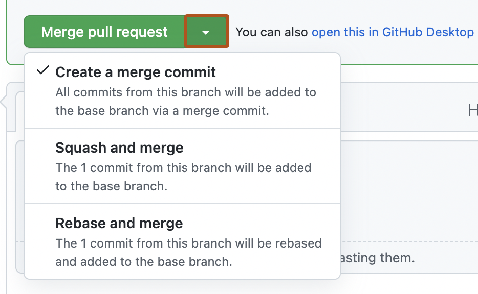

   [GitHub Docs · Usare Squash and merge](https://docs.github.com/en/pull-requests/how-tos/merge-and-close-pull-requests/merging-a-pull-request)

## Quando usare `@claude` e Copilot

Un membro con accesso **Write** può menzionare `@claude` in un nuovo commento. Scorri fino a **Add a comment**, scrivi la richiesta e clicca su **Comment**. Su un’issue chiedi chiarimenti come «Confronta il piano con i frame TF-01 e TF-02 e indica cosa manca». Su una PR interna puoi chiedere una spiegazione del diff o una correzione circoscritta al branch. La risposta compare come `claude[bot]`. Verifica sempre il diff prodotto e riavvia l’eventuale fase necessaria attraverso la label o **Ready for review**. [Esempio reale di risposta](https://github.com/unisa-gps-team08/MindCompanion/issues/2#issuecomment-7038372849).

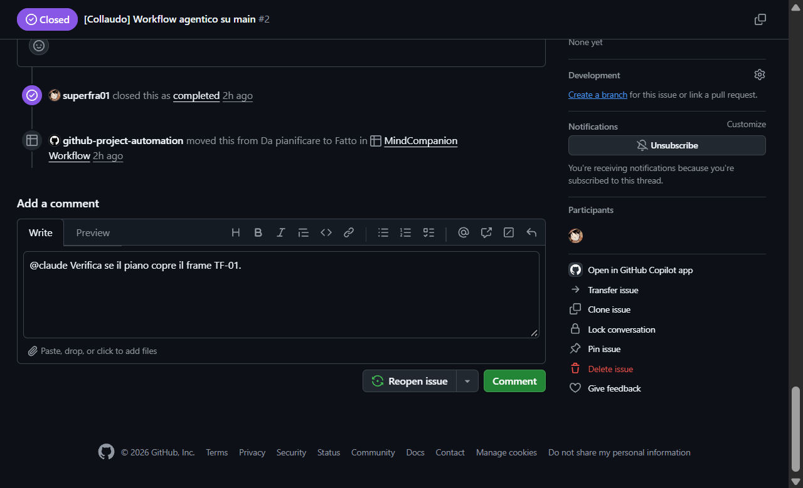

*Come scrivere la richiesta.* Inserisci `@claude` nel testo e usa **Comment**. GitHub pubblica il commento nella conversazione dell’issue.

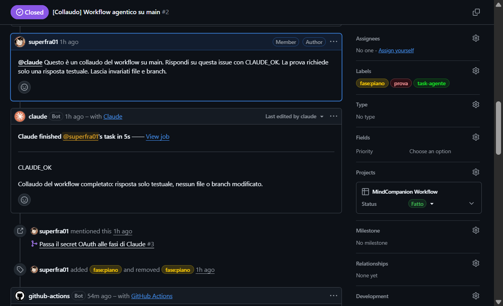

*Dove leggere la risposta.* Cerca il commento di Claude con il badge **Bot**. Il link **View job** apre il run di quella richiesta.

**Copilot Code Review** è una revisione tecnica aggiuntiva per account e repository idonei. Quando disponibile, si chiede da **Reviewers → Copilot**. Il team può abilitare la richiesta automatica importando il ruleset già presente nella repo. Durante il collaudo GitHub ha rifiutato l’assegnazione per mancanza di idoneità. L’approvazione richiesta per il merge è del code owner umano. [Istruzioni per Copilot](https://github.com/unisa-gps-team08/MindCompanion/blob/main/.github/copilot-instructions.md) · [Ruleset Copilot](https://github.com/unisa-gps-team08/MindCompanion/blob/main/.github/rulesets/copilot-code-review.json)

## Segui i task nella board

La board privata **MindCompanion Workflow** ha sei colonne **Da pianificare**, **Piano**, **Implementazione**, **Test**, **Revisione** e **Fatto**. Il PM aggiorna lo stato intermedio e può compilare **Caso d’uso**, **Agente usato**, **Tentativi** e **Revisore**. Le label avviano i workflow su GitHub Actions. La colonna **Status** serve a rendere visibile il lavoro.

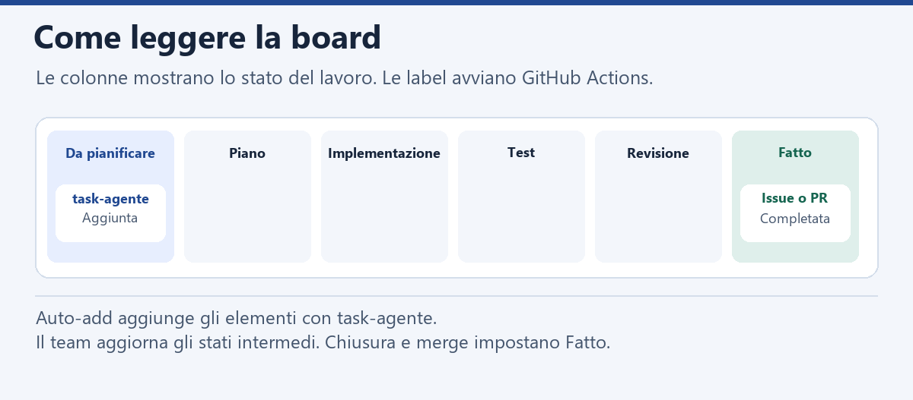

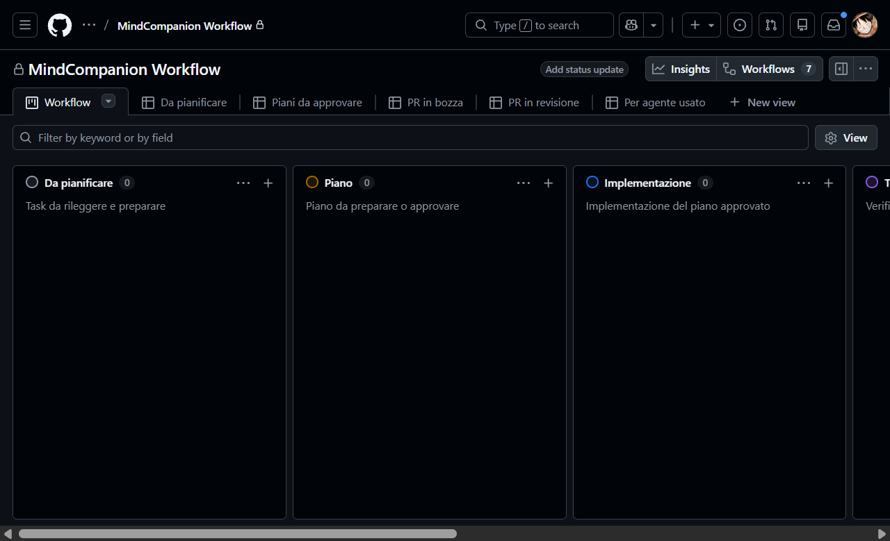

*Board di MindCompanion.* In alto, clicca su una scheda per cambiare vista. Nella vista **Workflow**, scorri orizzontalmente per vedere anche **Test**, **Revisione** e **Fatto**. Apri la scheda del task per vedere il collegamento all’issue.

- **Auto-add to project** aggiunge gli elementi della repo con `task-agente`.
- **Item closed** e **Pull request merged** spostano l’elemento in **Fatto**.
- **Auto-close issue** è attiva. Usa **Fatto** quando l’issue si può chiudere.
- Le viste **Da pianificare**, **Piani da approvare**, **PR in bozza**, **PR in revisione** e **Per agente usato** aiutano a trovare il prossimo intervento. **PR in revisione** usa lo stato della board. Per controllare la situazione effettiva di review e CI, usa le ricerche nella lista delle PR.

[Viste della board](https://github.com/orgs/unisa-gps-team08/projects/1/views/1) · [PR in attesa di review](https://github.com/unisa-gps-team08/MindCompanion/pulls?q=is%3Apr+is%3Aopen+-is%3Adraft+review%3Arequired) · [PR con CI fallita](https://github.com/unisa-gps-team08/MindCompanion/pulls?q=is%3Apr+is%3Aopen+status%3Afailure)

## Diagnosi e ripartenza

| Situazione | Cosa fare |
| --- | --- |
| Il run è **Skipped** o non compare | Controlla la label, il tipo di elemento, lo stato della PR e i permessi di chi ha eseguito l’azione. Apri **Actions** e seleziona il workflow interessato. |
| L’implementazione dice che il piano è superato | Riesegui `fase:piano` sulla versione corrente dell’issue e di `main`. Leggi il nuovo piano prima di applicare `fase:implementazione`. |
| Esiste già il branch o la PR del task | Apri la PR esistente. Se esiste solo il branch, verifica i commit e apri la PR in bozza. Il workflow evita di sovrascrivere il branch esistente. |
| La patch è fuori ambito o la PR è cambiata durante un run | Verifica diff e commit correnti. Correggi il perimetro nell’issue, se necessario rigenera il piano e riavvia la fase sull’elemento aggiornato. |
| Il check applicativo è rosso | Apri il job `build` o il link nel commento **Test dei frame**. Leggi il primo errore, riproducilo con `bash .github/scripts/verify-project` e verifica di nuovo dopo la correzione. |
| La PR è pronta ma il revisore non ha prodotto un report | Controlla i log di **Agente revisore**. Per una PR che cambia i file del workflow, la GitHub App può sospendere l’esecuzione finché il workflow sulla PR differisce da `main`. In quel caso la review umana resta il passaggio da completare prima del merge. |
| OAuth risulta mancante, scaduto o rifiutato | Fai controllare il secret all’amministratore ed esegui **Verifica OAuth di Claude** su `main`. Se il controllo manuale passa ma una fase fallisce, verifica il passaggio del secret al workflow riutilizzabile. |

## Configurazione per chi mantiene il workflow

La configurazione è già presente su `main`. La GitHub App ufficiale di Claude è installata sul solo MindCompanion. L’action scambia l’identità del runner via OIDC per un token GitHub temporaneo. Il secret `CLAUDE_CODE_OAUTH_TOKEN` dell’environment **MindCompanion Workflow** autentica le chiamate al modello con l’abbonamento Claude. I job che pubblicano commenti, commit e PR usano i propri permessi GitHub Actions.

- Per sostituire il token, il titolare dell’abbonamento esegue `claude setup-token` e aggiorna il secret in **Settings → Environments → MindCompanion Workflow**. Conserva il valore nel secret di GitHub.
- Per provare che un evento può avviare Actions e pubblicare un commento, aggiungi `prova` a un’issue di collaudo aperta. **Saluto** deve rispondere **Ciao!**.
- Da **Actions → Verifica OAuth di Claude → Run workflow**, scegli `main`. Il run verifica sia OIDC sia la risposta del modello. Per controllare anche l’inoltro alle fasi riutilizzabili, prova `fase:piano` su un’issue di collaudo con riferimenti validi.
- GitHub Actions ha permessi predefiniti in lettura. **Allow GitHub Actions to create and approve pull requests** è attivo per consentire l’apertura automatica delle PR in bozza. Il ruleset `protect-main` richiede il check `build` e la revisione di un code owner.
- Il ruleset include un’eccezione già configurata per il team `pm`. Per il flusso ordinario, attendi review e check richiesti e usa il merge standard.
- I limiti del job Claude sono 15 minuti e 15 turni per il piano, 30 minuti e 40 turni per l’implementazione, 30 minuti e 30 turni per i test, 15 minuti e 20 turni per la revisione. Il consumo ricade sull’abbonamento associato al token. Quando una fase si interrompe più volte, il team valuta i log e decide se restringere il task o proseguire manualmente.

| File | Funzione |
| --- | --- |
| `piano.yml`, `implementa.yml`, `test.yml`, `revisione.yml` | Definiscono gli eventi, le condizioni, i permessi e i limiti delle singole fasi. |
| `esegui-fase.yml` | Riusa i job che preparano il contesto, eseguono Claude, verificano le patch e pubblicano il risultato. |
| `agente.yml`, `ci.yml`, `saluto.yml`, `oauth.yml` | Gestiscono le menzioni, la CI e le prove di configurazione. |
| `.github/scripts/agent_workflow.py` | Controlla ruolo del mittente, riferimenti del piano e ambito delle patch. Pubblica commenti, commit e PR. |
| `AGENTS.md`, `CLAUDE.md`, `.claude/agents/` | Definiscono le regole del progetto e le istruzioni dei ruoli di test e revisione. |

[Workflow su GitHub](https://github.com/unisa-gps-team08/MindCompanion/tree/main/.github/workflows) · [Environment GitHub](https://github.com/unisa-gps-team08/MindCompanion/settings/environments) · [Documentazione Claude Code per GitHub Actions](https://code.claude.com/docs/en/github-actions)

## Cosa è già stato verificato

Su `main` sono stati verificati OAuth e OIDC, la risposta **Ciao!** del workflow **Saluto**, la risposta di `claude[bot]`, la pubblicazione del piano e l’inserimento automatico dell’issue nella board. Alla chiusura dell’issue di prova, GitHub Projects ha impostato **Fatto**. Il giro completo di implementazione, test e revisione applicativa richiede ancora un caso d’uso approvato, il codice e lo script di verifica del progetto.

[Issue di collaudo](https://github.com/unisa-gps-team08/MindCompanion/issues/2) · [Piano pubblicato](https://github.com/unisa-gps-team08/MindCompanion/issues/2#issuecomment-7038505212) · [Run OAuth riuscito](https://github.com/unisa-gps-team08/MindCompanion/actions/runs/44727651085)
