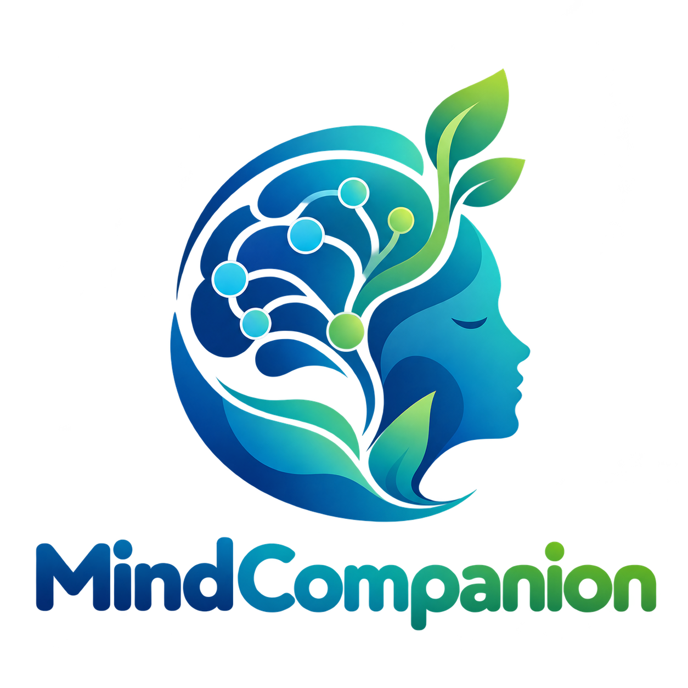
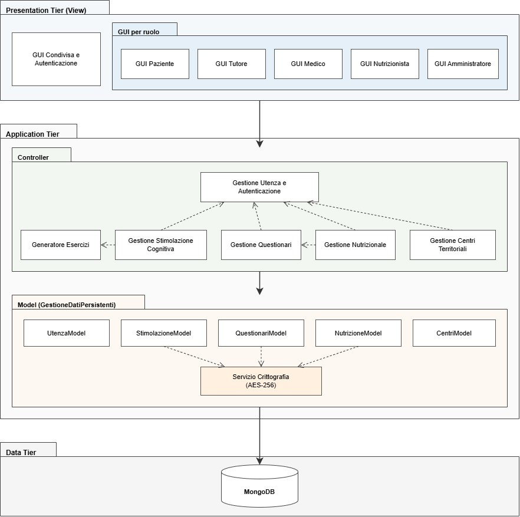
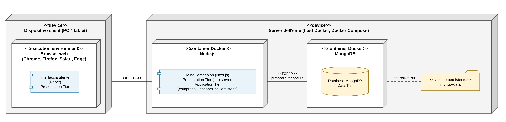
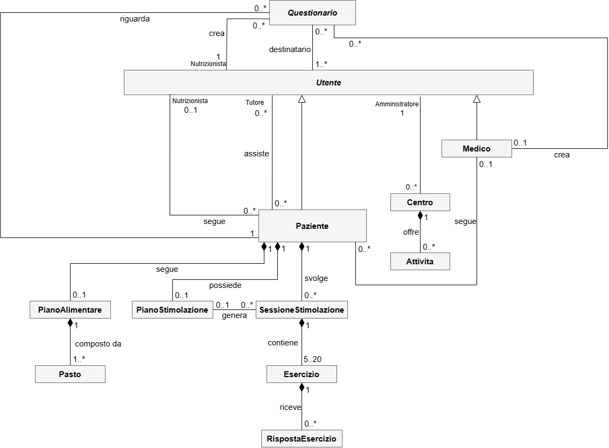
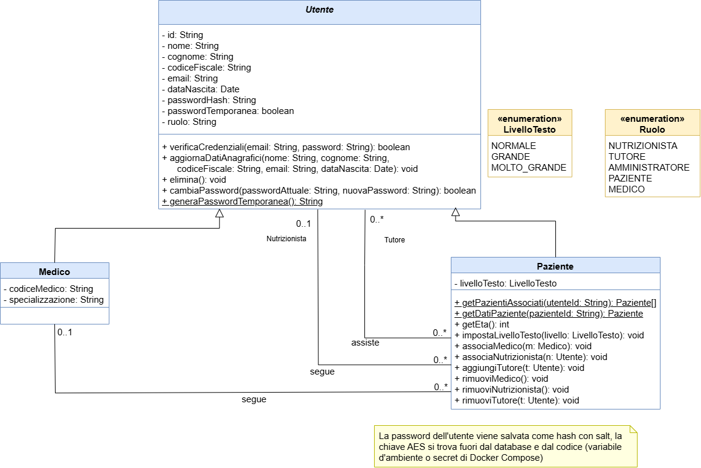
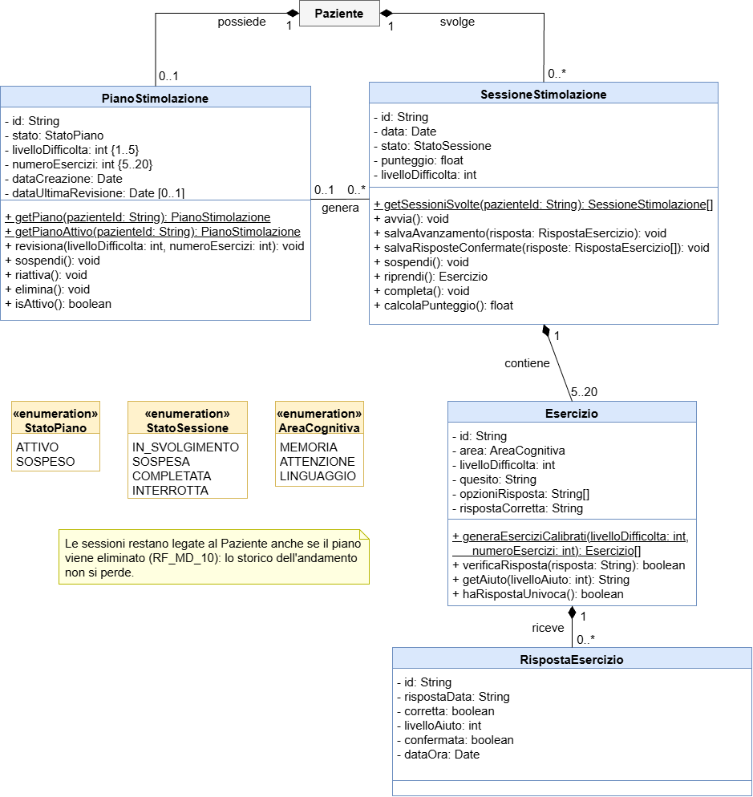
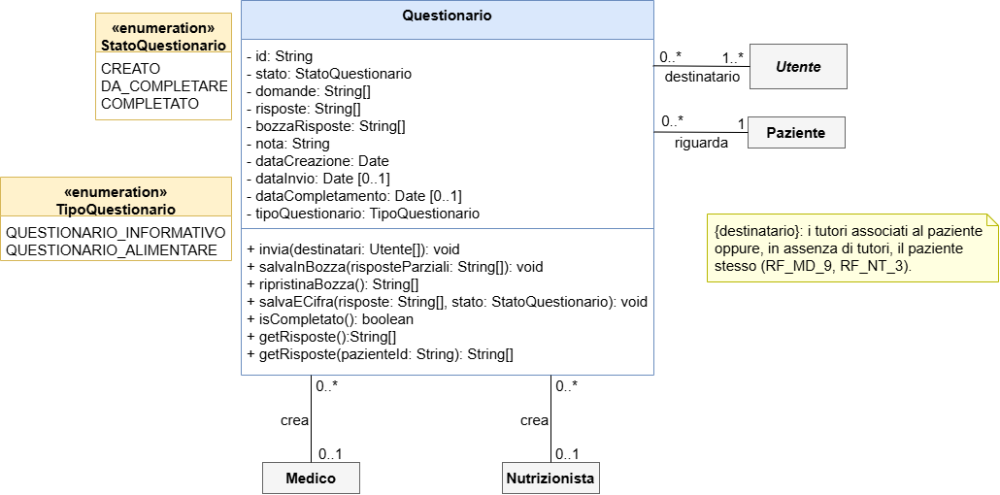
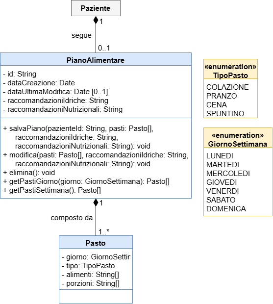
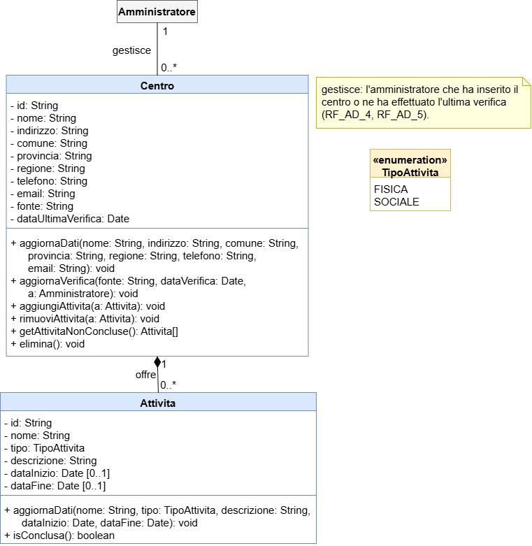

# System Design Document

| **Riferimento** | C08_SDD |
| --- | --- |
| **Versione** | 0.2 |
| **Data** | 23/11/2026 |
| **Destinatario** | RSA; Cooperative; Enti Pubblici; |
| **Presentato da** | Gianluca Scisciolo, Gabriele Santoro,  Francesco Rao |
| **Approvato da** |  |

---

## Revision History

| **Data** | **Versione** | **Descrizione** | **Autori** |
| :---: | :---: | :---: | :---: |
| 16/11/2026 | 0.1 | Prima stesura | Tutto il Team |
| 23/11/2026 | 0.2 | Revisione SDD | Tutto il Team |

| **Nominativo** | **Ruolo** |
| :---: | :---: |
| Gabriele Santoro | Project Manager |
| Francesco Rao | Project Manager |
| Gianluca Scisciolo | Project Manager |
| Gaetano Frati | Team Member  |
| David De Pascale | Team Member |
| Massimo Giudice | Team Member |
| Antonio Bassano | Team Member |
| Luigi Alessio Pascarella | Team Member |
| Angelo Rainone | Team Member |
| Antonello Laudato | Team Member |

## Indice

- [1. Introduzione](#1-introduzione)
  - [1.1 Scopo del sistema](#11-scopo-del-sistema)
  - [1.2 Obiettivi di Design (Design Goals)](#12-obiettivi-di-design-design-goals)
    - [1.2.1 Trade-Offs](#121-trade-offs)
  - [1.3 Definizioni, acronimi e abbreviazioni](#13-definizioni-acronimi-e-abbreviazioni)
  - [1.4 Riferimenti](#14-riferimenti)
  - [1.5 Panoramica](#15-panoramica)
- [2. Architettura del sistema Corrente](#2-architettura-del-sistema-corrente)
- [3. Architettura del Sistema Proposto](#3-architettura-del-sistema-proposto)
  - [3.1 Panoramica](#31-panoramica)
  - [3.2 Decomposizione in sottosistemi](#32-decomposizione-in-sottosistemi)
    - [3.2.1 Diagramma dei sottosistemi](#321-diagramma-dei-sottosistemi)
  - [3.3 Mapping Hardware/Software](#33-mapping-hardwaresoftware)
    - [3.3.1 Deployment Diagram](#331-deployment-diagram)
- [4. Gestione dei Dati Persistenti](#4-gestione-dei-dati-persistenti)
  - [4.1 Introduzione](#41-introduzione)
  - [4.2 Class Diagram Ristrutturato](#42-class-diagram-ristrutturato)
- [5. Glossario](#5-glossario)

---

# 1. Introduzione

## 1.1 Scopo del sistema

MindCompanion è una piattaforma web che supporta la stimolazione cognitiva di persone con decadimento cognitivo lieve o demenza, tra cui la malattia di Alzheimer, e delle figure che le assistono: tutore, medico e nutrizionista. Il sistema permette al medico di assegnare e rivedere un piano di stimolazione personalizzato e al paziente di svolgere sessioni di esercizi con feedback empatici. Permette inoltre di raccogliere informazioni cliniche e alimentari tramite questionari, di gestire i piani alimentari e di consultare un catalogo di centri e attività sul territorio. Un amministratore gestisce utenti, associazioni e catalogo.

Il presente System Design Document (SDD) descrive come MindCompanion verrà realizzato. Traduce i requisiti funzionali e non funzionali definiti nel Requirements Analysis Document (RAD), in particolare i vincoli su sicurezza, affidabilità, prestazioni, usabilità e portabilità. Il documento definisce:

- gli obiettivi di progetto (design goal), ciascuno derivato da uno o più requisiti non funzionali del RAD;

- l'architettura del sistema, di tipo Three-Tier combinata con il pattern MVC, e la sua decomposizione in sottosistemi;

- la mappatura hardware/software e la gestione dei dati persistenti, con il passaggio dal modello a oggetti del RAD allo schema NoSQL su MongoDB, comprese la cifratura dei dati sanitari e i compromessi adottati.

## 1.2 Obiettivi di Design (Design Goals)

I design goal derivano dai requisiti non funzionali del RAD. Il grado indica l’importanza del goal (1 = massima), in base alla priorità del requisito e alla criticità per i pazienti e per i loro dati sanitari.

| **Grado** | **ID Design Goal** | **Descrizione** | **Categoria** | **RNF di origine** |
| :---: | :---: | :---: | :---: | :---: |
| **1** | DG_1 Sicurezza | I dati sanitari dei pazienti devono essere cifrati con AES-256 e non risultare leggibili in chiaro nel database. | Dependability | RNF_FUN_4 |
| **2** | DG_2 Sicurezza | Ogni utente deve accedere solo alle funzioni e ai dati del proprio ruolo; le richieste non autorizzate vengono rifiutate. | Dependability | RNF_FUN_3 |
| **3** | DG_3 Affidabilità | In caso di interruzione della connessione, il sistema deve recuperare il 100% delle risposte già confermate durante una sessione. | Dependability | RNF_AFF_1 |
| **4** | DG_4 Affidabilità | Il sistema deve conservare l’ultima bozza dei questionari e ripristinarla, completa, alla riconnessione o al successivo accesso. | Dependability | RNF_AFF_2 |
| **5** | DG_5 Correttezza | Ogni esercizio generato deve avere una e una sola risposta esatta; i quesiti ambigui o insolubili vengono scartati. | Dependability | RNF_FUN_2 |
| **6** | DG_6 Usabilità | Un errore del paziente non deve generare messaggi punitivi né allarmi sonori, ma messaggi empatici e rassicuranti. | End User | RNF_USA_1 |
| **7** | DG_7 Usabilità | La sessione giornaliera deve essere raggiungibile al massimo in due tocchi e i menu del paziente non devono superare i tre livelli. | End User | RNF_USA_2 RNF_USA_4 |
| **8** | DG_8 Prestazioni | Il sistema deve generare e caricare gli esercizi calibrati in meno di 15 secondi nel 90% dei casi. | Performance | RNF_PRE_1 |
| **9** | DG_9 Portabilità | L’interfaccia deve essere responsive (da 768 px) e funzionare su Chrome, Firefox, Safari ed Edge all’ultima versione stabile. | Manutenibilità  | RNF_SO_1 RNF_OPE_1 |
| **10** | DG_10 Manutenibilità | L’architettura deve essere modulare, per realizzare al primo rilascio i requisiti funzionali ad alta priorità. | Maintenance | RNF_FUN_1 |
| **11** | DG_11 Manutenibilità | Il sistema deve essere sviluppato con un unico stack diffuso e documentato (Next.js, React, TypeScript, MongoDB). | Maintenance | RNF_IMP_1 RNF_IMP_2 |
| **12** | DG_12 Usabilità | I testi per il paziente devono avere dimensione di almeno 18 px e contrasto con lo sfondo di almeno 4,5:1 (WCAG 2.1 AA). | End User | RNF_USA_3 |
| **13** | DG_13 Usabilità | Ogni schermata del paziente deve evidenziare una sola azione principale, con al massimo 3 elementi secondari e istruzioni di al massimo 15 parole. | End User | RNF_USA_5 RNF_USA_6 |

### 1.2.1 Trade-Offs

Di seguito sono riportati i compromessi adottati tra design goal in conflitto.

| **Trade-Off** | **Descrizione** |
| :---: | :---: |
| **Sicurezza vs Usabilità** | Al fine di proteggere i dati sanitari, il controllo degli accessi e la cifratura sono realizzati lato server, senza passaggi aggiuntivi per il paziente oltre al login, così da non appesantire un’interfaccia pensata per persone con demenza. |
| **Tempo di risposta vs Correttezza degli esercizi** | Al fine di garantire una sola risposta esatta per quesito, la generazione degli esercizi include una validazione formale che ne aumenta il tempo di elaborazione; in caso di conflitto prevale sempre la correttezza dei quesiti. Il sistema completa la generazione entro 15 secondi nel 90% dei casi, nel restante 10%  la generazione prosegue senza interrompersi  |
| **Tempo di risposta vs Affidabilità** | Al fine di non perdere i progressi, l’avanzamento è salvato a ogni risposta confermata e le bozze a intervalli regolari, a discapito di un maggior numero di scritture sul database. |
| **Flessibilità vs Integrità dei dati** | L’uso di MongoDB offre flessibilità e rapidità di sviluppo, ma non impone l’integrità referenziale: le regole di cardinalità tra utenti (RF_AD_8) sono quindi garantite a livello applicativo. Inoltre quando un utente viene associato con un altro viene prima effettuato un controllo per verificare che egli abbia il ruolo appropriato all'associazione da aggiungere (ad esempio solo un Tutore può assistere un paziente, o solo un Nutrizionista può seguire un paziente). |
| **Funzionalità vs Tempi di sviluppo** | Al fine di contenere i tempi, il primo rilascio comprende i requisiti ad alta priorità; funzionalità a priorità bassa o media, come l’ingrandimento del testo (RF_PZ_7) e l’ordinamento dei centri (RF_TT_7), possono essere rinviate e aggiunte negli sviluppi successivi della piattaforma. |

## 1.3 Definizioni, acronimi e abbreviazioni

**Definizioni:** vedi Glossario

Acronimi:

- AES-256: Advanced Encryption Standard a 256 bit;

- BSON: Binary JSON;

- DBMS: Database Management System;

- DG: Design Goal;

- UI: User Interface;

- HTTP / HTTPS: HyperText Transfer Protocol / HyperText Transfer Protocol Secure;

- JSON: JavaScript Object Notation;

- MVC: Model-View-Controller;

- NoSQL: Not Only SQL;

- RAD: Requirement Analysis Document;

- RF: Requisito Funzionale;

- RNF: Requisito Non Funzionale;

- RSA: Residenza Sanitaria Assistenziale;

- SDD: System Design Document;

- SOW: Statement of Work;

- TCP/IP: Transmission Control Protocol / Internet Protocol;

- TLS: Transport Layer Security;

- UML: Unified Modeling Language;

- WCAG 2.1: Web Content Accessibility Guidelines versione 2.1.

Abbreviazioni, ruoli utente usati negli identificativi dei requisiti:

- PZ: Paziente;

- TT: Tutore;

- MD: Medico;

- NT: Nutrizionista;

- AD: Amministratore.

Prefissi delle categorie dei RNF, usati nella notazione RNF_[categoria]_[numero]:

- FUN: Funzionalità;

- USA: Usabilità;

- AFF: Affidabilità;

- PRE: Prestazioni;

- SO: Sostenibilità;

- IMP: Implementazione;

- OPE: Operazione.

## 1.4 Riferimenti

- **B. Bruegge, A.H. Dutoit**, *Object Oriented Software Engineering - Using UML, Patterns and Java*, Prentice Hall.

- **Documento di Statement of Work (SOW)** relativo al progetto MindCompanion.

- **Documento di Requirement Analysis Document (**`C08_RAD`**, v2.0)** relativo al progetto MindCompanion.

## 1.5 Panoramica

Il presente documento è organizzato in 5 capitoli:

- **1. Introduzione:** Delinea lo scopo del sistema, definisce gli obiettivi di progettazione (*Design Goals*) derivati dai requisiti non funzionali del RAD e i relativi compromessi progettuali (*Trade-Offs*), ed elenca definizioni, acronimi, abbreviazioni e riferimenti documentali.

- **2. Architettura del sistema Corrente:** Descrive lo stato attuale delle soluzioni digitali esistenti per l'allenamento cognitivo (quali NeuronUP e RehaCom), evidenziando la separazione tra stimolazione cognitiva e gestione clinico-assistenziale che motiva l'adozione del sistema proposto.

- **3. Architettura del Sistema Proposto:** Presenta lo stile architetturale *Three-Tier* combinato con il pattern *MVC*, la decomposizione nei sottosistemi di *Presentation Tier* (View), *Application Tier* (Controller e Model con servizio di crittografia AES-256) e *Data Tier* (MongoDB) corredata dai relativi diagrammi, nonché il *Mapping Hardware/Software* e il *Deployment Diagram*.

- **4. Gestione dei Dati Persistenti:** Illustra la scelta del DBMS NoSQL orientato ai documenti (MongoDB in formato BSON) e presenta il *Class Diagram ristrutturato*, dettagliando le modifiche apportate rispetto al modello a oggetti del RAD per adattarlo alla persistenza documentale.

- **5. Glossario:** Raccoglie i termini tecnici e di dominio utilizzati nella stesura del documento con la relativa definizione.

# 2. Architettura del sistema Corrente

Oggi esistono diverse piattaforme digitali, come ad esempio, NeuronUP e RehaCom, per l'allenamento cognitivo per le persone affette da Alzheimer, o demenza senile, in fase avanzata o iniziale. Tuttavia, queste piattaforme offrono solo servizi di allenamenti cognitivi lasciando la gestione del paziente dal punto di vista medico o assistenziale separatamente. MindCompanion, a differenza, offre tutte le funzionalità di allenamento cognitivo e supporto all'assistenza medica del paziente in un'unica piattaforma digitale.

# 3. Architettura del Sistema Proposto

## 3.1 Panoramica

La piattaforma MindCompanion è un’applicazione web pensata per persone con decadimento cognitivo lieve o demenza, tra cui la malattia di Alzheimer, e per le figure che le assistono: medico, tutore e nutrizionista. La persistenza dei dati è affidata a un database NoSQL (MongoDB), con cifratura dei dati sanitari di ogni utente.

L’architettura scelta è di tipo **Three-Tier**, combinata con il pattern **MVC**. Il sistema è suddiviso nei seguenti livelli:

- **Presentation tier**: contiene la **View**, che mostra i dati agli utenti e ne raccoglie gli input, senza accedere direttamente ai dati.

- **Application tier**: contiene il **Controller**, che riceve gli eventi generati dagli utenti attraverso le View, verifica i permessi in base al ruolo, esegue le operazioni richieste e restituisce l'esito alla View, che lo mostra all'utente; e il **Model**, che rappresenta le entità del dominio, applica la cifratura dei dati sensibili e fornisce i metodi per accedere ai dati persistenti. In questo livello risiede anche la logica applicativa, in particolare il generatore di esercizi (con i validatori formali) e la gestione del salvataggio di risposte e bozze.

- **Data tier**: il database MongoDB, raggiungibile solo dal livello applicativo. I tre tier sono livelli logici, non macchine separate: l'Application Tier e il Data Tier sono eseguiti sullo stesso nodo fisico, il server dell'ente, in container distinti (sezione 3.3)

Il flusso è unidirezionale: la View comunica solo con il Controller, il Controller con il Model, e solo il Model accede al database.

Questa architettura garantisce una separazione netta tra presentazione, logica e dati. Il client non può raggiungere il database, e controllo degli accessi e cifratura sono realizzati a livello applicativo, rispettando DG_2 e DG_1. Inoltre, il livello applicativo ospita la logica più onerosa: il generatore di esercizi con validatori formali (DG_5) e il salvataggio a ogni risposta confermata e delle bozze (DG_3, DG_4). Il generatore è un componente isolato, così da poterlo ottimizzare per rispettare i tempi di risposta senza modificare il resto del sistema (DG_8).

## 3.2 Decomposizione in sottosistemi

In coerenza con lo stile architetturale Three-Tier combinato con il pattern MVC, MindCompanion adotta un’**architettura stratificata chiusa**. Ogni livello utilizza esclusivamente i servizi offerti dal livello immediatamente sottostante, secondo un flusso di dipendenze strettamente **unidirezionale verso il basso**.

**Presentation Tier** (View): Ospita le interfacce web responsive realizzate con React e Next.js, senza accesso diretto ai dati persistenti. È suddiviso in:

- GUI Condivisa e Autenticazione: Gestisce accesso, logout e finestre di messaggi o errore comuni a tutti gli attori.

- GUI per ruolo (GUI Paziente, GUI Tutore, GUI Medico, GUI Nutrizionista, GUI Amministratore): contengono le pagine e i form specifici di ciascun attore, che inviano le richieste ai sottosistemi del Controller.

**Application Tier** (Controller e Model): Eseguito lato server con Next.js e TypeScript, concentra la logica applicativa, i controlli di sicurezza e l’accesso ai dati, separandoli in due strati interni:

- Controller (Logica applicativa):

  - Gestione Utenza e Autenticazione: Gestisce login, logout, cambio password, la generazione delle password temporanee, l'esportazione delle credenziali, il cambio obbligatorio al primo accesso, la chiusura delle altre sessioni dopo il cambio password, controllo degli accessi per ruolo, anagrafici utenti e associazioni tra pazienti e figure di supporto nel rispetto delle cardinalità previste. È il modulo trasversale da cui dipendono tutti gli altri sottosistemi di controllo per la verifica dei permessi.

  - Gestione Stimolazione Cognitiva: Coordina il ciclo di vita dei piani di stimolazione, l’esecuzione delle sessioni con salvataggio progressivo e il monitoraggio dell’andamento.

  - Generatore Esercizi: Sottosistema isolato, invocato da *Gestione Stimolazione Cognitiva*, che genera gli esercizi calibrati sul piano del paziente e ne garantisce l’univocità tramite validatori formali.

  - Gestione Questionari: Coordina creazione, invio, salvataggio in bozza, compilazione e consultazione dei questionari informativi e alimentari.

  - Gestione Nutrizionale: Gestisce il ciclo di vita e la consultazione dei piani alimentari, interagendo con *Gestione Questionari* per accedere alle risposte alimentari del paziente.

  - Gestione Centri Territoriali: Gestisce il catalogo verificato dei centri e delle attività, la ricerca per area geografica e l’esclusione degli eventi conclusi.

- Model (GestioneDatiPersistenti): È l’unico strato dell’Application Tier che comunica con il database. Organizza le entità di dominio in cinque moduli (UtenzaModel, StimolazioneModel, QuestionariModel, NutrizioneModel, CentriModel) e integra un Servizio Crittografia (AES-256) invocato selettivamente dai moduli che trattano dati sanitari (*StimolazioneModel*, *QuestionariModel* e *NutrizioneModel*), mantenendo interrogabili i dati anagrafici e il catalogo dei centri.

**Data Tier**: È costituito dal DBMS NoSQL MongoDB, responsabile della memorizzazione persistente dei documenti in formato BSON. È isolato dall’esterno e accessibile esclusivamente dal livello applicativo tramite il modulo GestioneDatiPersistenti (Model).

| **Control (RAD)** | **RF** | **Sottosistema (SDD)** |
| --- | --- | --- |
| AutenticazioneControl | RF_UE_1, RF_UE_2 | Gestione Utenza e Autenticazione |
| CambiaPasswordControl | RF_UE_3 | Gestione Utenza e Autenticazione |
| IngrandimentoTestoControl | RF_PZ_7 | Gestione Utenza e Autenticazione |
| VisualizzaElencoUtentiControl | RF_AD_7 | Gestione Utenza e Autenticazione |
| InserisciUtenteControl | RF_AD_1 | Gestione Utenza e Autenticazione |
| ModificaUtenteControl | RF_AD_2 | Gestione Utenza e Autenticazione |
| EliminaUtenteControl | RF_AD_3 | Gestione Utenza e Autenticazione |
| AssegnaAssociazioniUtenteControl | RF_AD_8 | Gestione Utenza e Autenticazione |
| ModificaAssociazioniUtenteControl | RF_AD_10 | Gestione Utenza e Autenticazione |
| RimuoviAssociazioniUtenteControl | RF_AD_11 | Gestione Utenza e Autenticazione |
| VisualizzaElencoPazientiControl | RF_MD_3, RF_NT_6, RF_TT_9 | Gestione Utenza e Autenticazione |
| CreazionePianoStimolazioneControl | RF_MD_1 | Gestione Stimolazione Cognitiva |
| RevisionePianoStimolazioneControl | RF_MD_4 | Gestione Stimolazione Cognitiva |
| SospensionePianoStimolazioneControl | RF_MD_5 | Gestione Stimolazione Cognitiva |
| RiattivazionePianoStimolazioneControl | RF_MD_6 | Gestione Stimolazione Cognitiva |
| EliminazionePianoStimolazioneControl | RF_MD_10 | Gestione Stimolazione Cognitiva |
| SvolgiSessioneControl | RF_PZ_1 | Gestione Stimolazione Cognitiva |
| VisualizzaAndamentoPazienteControl | RF_MD_2, RF_PZ_2, RF_TT_2 | Gestione Stimolazione Cognitiva |
| CreaQuestionarioInformativoControl | RF_MD_7 | Gestione Questionari |
| InviaQuestionarioInformativoControl | RF_MD_9 | Gestione Questionari |
| CompilaQuestionarioInformativoControl | RF_TT_8, RF_PZ_5 | Gestione Questionari |
| CreaQuestionarioAlimentareControl | RF_NT_3 | Gestione Questionari |
| CompilaQuestionarioPianoAlimentareControl | RF_TT_5, RF_PZ_4 | Gestione Questionari |
| VisualizzaRisposteQuestionarioControl | RF_MD_8, RF_NT_2 | Gestione Questionari |
| CreaPianoAlimentareControl | RF_NT_1 | Gestione Nutrizionale |
| ModificaPianoAlimentareControl | RF_NT_4 | Gestione Nutrizionale |
| EliminaPianoAlimentareControl | RF_NT_5 | Gestione Nutrizionale |
| VisualizzaPianoAlimentareControl | RF_NT_7, RF_PZ_3, RF_TT_1 | Gestione Nutrizionale |
| RicercaCentriControl | RF_TT_3, RF_TT_6, RF_TT_7 | Gestione Centri Territoriali |
| VisualizzaDettaglioCentroControl | RF_TT_4 | Gestione Centri Territoriali |
| VisualizzaElencoCentriControl | RF_AD_9 | Gestione Centri Territoriali |
| InserimentoCentroControl | RF_AD_4 | Gestione Centri Territoriali |
| ModificaCentroControl | RF_AD_5 | Gestione Centri Territoriali |
| RimozioneCentroControl | RF_AD_6 | Gestione Centri Territoriali |

*Tabella: corrispondenza tra i control del RAD e i sottosistemi dell'Application Tier*

### 3.2.1 Diagramma dei sottosistemi

## 3.3 Mapping Hardware/Software

MindCompanion è un sistema client/server basato sul web. I tre tier dell'architettura sono livelli logici: il Presentation Tier è eseguito in parte sul dispositivo client, mentre l'Application Tier e il Data Tier sono eseguiti sullo stesso nodo fisico, il server dell'ente (RSA, cooperativa o ASL), in container distinti. Il deployment prevede quindi due nodi hardware:

- Dispositivo client: PC o tablet dell'utente con schermo di larghezza pari o superiore a 768 px (RNF_SO_1), sul quale è in esecuzione un browser web tra Google Chrome, Mozilla Firefox, Apple Safari e Microsoft Edge aggiornato all'ultima versione stabile (RNF_OPE_1). Il browser esegue i componenti React del Presentation Tier. Sul client non è richiesta alcuna installazione.

- Server dell'ente: macchina dell'ente su cui è installato Docker e sulla quale sono in esecuzione due container, avviati insieme tramite Docker Compose:

  - container applicativo (ambiente Node.js) che esegue l'applicazione Next.js (RNF_IMP_2): la parte lato server del Presentation Tier (generazione delle pagine) e tutti i sottosistemi dell'Application Tier, compreso GestioneDatiPersistenti;

  - container database che esegue il DBMS MongoDB (RNF_IMP_1), con i dati memorizzati su un volume persistente di Docker, che conserva i dati anche quando il container viene riavviato o ricreato.

Comunicazione tra i nodi:

- Client – Container applicativo: protocollo HTTPS (HTTP su TLS). Il browser invia le richieste dell'utente e riceve le pagine e i dati in risposta; la cifratura TLS protegge in transito le credenziali e i dati sanitari dei pazienti.

- Container applicativo – Container database: protocollo di rete di MongoDB su TCP/IP, tramite il driver MongoDB per Node.js. Il database è raggiungibile solo dal container applicativo e non è esposto ai client.

Nota – Ambiente di sviluppo: durante lo sviluppo ogni membro del team esegue una propria copia del sistema (applicazione e database) con lo stesso file Docker Compose, così che l'ambiente di esecuzione sia identico su ogni macchina.

### 3.3.1 Deployment Diagram

*Figura: Deployment diagram di MindCompanion*

# 4. Gestione dei Dati Persistenti

## 4.1 Introduzione

Per la gestione dei dati persistenti la scelta è ricaduta su un database NoSQL, ovvero un database non relazionale. La scelta di MongoDB è imposta da RNF_IMP_1 e poiché si adatta inoltre ai dati della piattaforma per la flessibilità e dalla capacità di conservare e gestire più tipi di dati rispetto ad un database relazionale tradizionale. Ogni documento può avere campi diversi e strutture diverse, senza dover andare a modificare l'intera struttura del database. Questo diventa essenziale per la piattaforma MindCompanion nella quale sono presenti strutture dati polimorfiche o annidate (es quesiti diversi per tipologia di esercizio cognitivo, domande e risposte dinamiche dei questionari, documenti aggregati per piano/settimana).

## 4.2 Class Diagram Ristrutturato

Il metodo getQuestionario(): String[] dell'entità QuestionarioInformativo è stato inserito nell'entità Questionario con il nome getRisposte(): String[]. Il metodo getRisposte(pazienteId: String): String [] è stato inserito così com'è nell'entità questionario. I due metodi facevano sostanzialmente la stessa cosa, ovvero restituire le risposte del questionario, dunque la specializzazione è stata eliminata (in modo da diminuire le dipendenze), venendo sostituita dall'attributo "tipoQuestionario", e si sono creati due metodi dalla diversa implementazione ma dallo stesso nome. Le entità nutrizionista, tutore e amministratore sono state accorpate in Utente e la distinzione tra di esse sostituita con l'attributo ruolo mentre Medico e Paziente restano sottoclassi (hanno attributi e associazioni propri). L'attributo domande: String[] dell'entità Questionario è stato sostituito da un array di sotto-documenti incorporati nel documento del questionario, ciascuno con i campi testo, obbligatoria (boolean) e opzioni (String[]). In questo modo il sistema può validare i campi obbligatori e gestire le risposte a scelta multipla senza una collezione separata.

# 5. Glossario

| **Termine** | **Definizione** |
| --- | --- |
| **AES-256** | Algoritmo di crittografia simmetrica (Advanced Encryption Standard) con chiave a 256 bit. In MindCompanion cifra tutti i dati sanitari dei pazienti prima della scrittura nel database, in modo che nessun campo sanitario risulti leggibile in chiaro (DG_1). |
| **Application Tier** | Livello intermedio dell’architettura Three-Tier, eseguito lato server con Next.js e TypeScript. Contiene il Controller, il Model e la logica applicativa (generatore di esercizi, salvataggio di risposte e bozze). È l’unico livello che comunica con il database. |
| **Architettura stratificata chiusa** | Organizzazione del sistema in livelli sovrapposti in cui ciascun livello può usare solo i servizi del livello immediatamente sottostante. Le dipendenze sono quindi unidirezionali, dall’alto verso il basso. |
| **Bozza** | Stato intermedio di un questionario in compilazione, che conserva le risposte parziali. Il sistema la salva a intervalli regolari e la ripristina, completa, alla riconnessione o al successivo accesso (DG_4). |
| **BSON (Binary JSON)** | Formato binario di rappresentazione dei documenti, derivato da JSON, usato da MongoDB per l’archiviazione persistente. Supporta tipi di dato aggiuntivi rispetto a JSON ed è efficiente da leggere e scrivere. |
| **Client** | Dispositivo dell’utente (PC o tablet) sul quale un browser web esegue l’interfaccia della piattaforma. Non richiede installazioni e non accede mai direttamente ai dati persistenti. |
| **Controller** | Componente del pattern MVC che riceve gli eventi generati dagli utenti tramite la View, verifica i permessi in base al ruolo, esegue le operazioni richieste e aggiorna la View. Nell’SDD è articolato in sei sottosistemi (utenza e autenticazione, stimolazione cognitiva, generatore esercizi, questionari, nutrizione, centri territoriali). |
| **Controllo degli accessi per ruolo** | Meccanismo di sicurezza, realizzato lato server, per cui ogni utente accede solo alle funzioni e ai dati previsti dal proprio ruolo. Ogni richiesta non autorizzata viene rifiutata (DG_2). |
| **Cifratura selettiva** | Scelta progettuale per cui il Servizio Crittografia viene invocato solo dai moduli che trattano dati sanitari (StimolazioneModel, QuestionariModel, NutrizioneModel). Dati anagrafici e catalogo dei centri restano in chiaro e quindi interrogabili. |
| **Dati anagrafici** | Informazioni identificative di base di un utente: nome, cognome, e-mail, codice fiscale e data di nascita. Non sono cifrati, perché devono restare interrogabili per la gestione di account e associazioni. |
| **Dati sanitari** | Dati clinici, anamnestici, nutrizionali e relativi alle sessioni di stimolazione del paziente. Sono i dati più sensibili del sistema e vengono sempre cifrati con AES-256 prima di essere memorizzati. |
| **Data Tier** | Livello dei dati dell’architettura Three-Tier, costituito dal database MongoDB. È isolato dall’esterno e raggiungibile esclusivamente dal livello applicativo tramite il modulo GestioneDatiPersistenti. |
| **DBMS (Database Management System)** | Software che gestisce la memorizzazione, l’organizzazione e l’accesso ai dati persistenti. In MindCompanion è un DBMS NoSQL orientato ai documenti (MongoDB). |
| **Deployment Diagram** | Diagramma UML che mostra l’allocazione dei componenti software sui nodi hardware del sistema e i collegamenti di comunicazione tra di essi (sezione 3.3.1). |
| **Design Goal (DG)** | Obiettivo di progettazione derivato da uno o più requisiti non funzionali del RAD. Ha un identificativo (DG_n) e un grado di importanza, dove 1 è il massimo, che dipende dalla priorità del requisito e dalla criticità per pazienti e dati sanitari. |
| **Generatore Esercizi** | Sottosistema isolato, invocato da Gestione Stimolazione Cognitiva, che produce esercizi calibrati sui parametri del piano del paziente. Essendo isolato, può essere ottimizzato per rispettare i tempi di risposta senza modificare il resto del sistema. |
| **GestioneDatiPersistenti** | Modulo Model dell’Application Tier, unico a comunicare con il database. Organizza le entità di dominio in cinque moduli (UtenzaModel, StimolazioneModel, QuestionariModel, NutrizioneModel, CentriModel) e integra il Servizio Crittografia. |
| **GUI (Graphical User Interface)** | Interfaccia grafica web del Presentation Tier, sviluppata con React e Next.js. È suddivisa in una GUI per ciascun ruolo (Paziente, Tutore, Medico, Nutrizionista, Amministratore) e in una GUI Condivisa per accesso, logout. |
| **HTTPS** | Versione sicura di HTTP, che cifra con TLS la comunicazione tra il browser del client e il server dell'ente. Protegge in transito le credenziali e i dati sanitari dei pazienti. |
| **Integrità referenziale** | Garanzia che i riferimenti tra entità siano sempre coerenti (ad esempio che un’associazione punti a un utente esistente). MongoDB non la impone: le regole di cardinalità tra utenti (RF_AD_8) sono quindi verificate a livello applicativo. |
| **Mapping Hardware/Software** | Descrizione di come i sottosistemi software vengono assegnati ai nodi hardware (dispositivo client e server dell'ente) e di quali protocolli li collegano (sezione 3.3). |
| **Model** | Componente del pattern MVC che rappresenta le entità del dominio, applica la cifratura ai dati sensibili e fornisce i metodi per accedere ai dati persistenti. Solo il Model accede al database. |
| **MongoDB** | DBMS NoSQL orientato ai documenti, scelto per la persistenza dei dati. Consente documenti con campi e strutture diverse, adatti alle strutture polimorfiche o annidate della piattaforma (esercizi, questionari, piani). |
| **MVC (Model-View-Controller)** | Pattern architetturale che separa i dati e la loro logica (Model), la presentazione (View) e il coordinamento tra le due (Controller). Nell’SDD è combinato con lo stile Three-Tier. |
| **Next.js / React / TypeScript** | Stack tecnologico unico adottato per l’intera piattaforma (DG_11): Next.js è il framework web, React la libreria per l’interfaccia, TypeScript il linguaggio tipizzato usato lato client e lato server. |
| **NoSQL** | Famiglia di database non relazionali, che non richiedono uno schema rigido. Permettono di modificare la struttura dei dati senza ristrutturare l’intero database. |
| **Persistenza progressiva** | Strategia di salvataggio incrementale: l’avanzamento è salvato a ogni risposta confermata e le bozze a intervalli regolari. Permette di recuperare il 100% delle risposte già confermate in caso di interruzione (DG_3, DG_4), al costo di più scritture sul database. |
| **Presentation Tier** | Livello di presentazione, che ospita la View. Mostra i dati agli utenti e ne raccoglie gli input, senza accedere direttamente ai dati persistenti. |
| **Responsive** | Capacità dell’interfaccia di adattarsi alle dimensioni dello schermo. In MindCompanion è garantita a partire da 768 px di larghezza e sui browser Chrome, Firefox, Safari ed Edge all’ultima versione stabile (DG_9). |
| **Servizio Crittografia** | Componente del Model che applica la cifratura AES-256 in scrittura e la decifratura in lettura. È invocato selettivamente dai moduli che trattano dati sanitari. |
| **Sottosistema** | Parte coesa del sistema, con responsabilità ben definite e interfacce verso le altre parti. È l’unità in cui l’SDD scompone il sistema (sezione 3.2). |
| **Three-Tier** | Stile architetturale a tre livelli: Presentation Tier, Application Tier e Data Tier. Garantisce una separazione netta tra presentazione, logica e dati. |
| **Trade-Off** | Compromesso adottato quando due design goal sono in conflitto (ad esempio sicurezza e usabilità). Per ciascuno l’SDD indica quale goal prevale e perché (sezione 1.2.1). |
| **Validatore formale** | Controllo integrato nella generazione degli esercizi che verifica che ogni quesito abbia una e una sola risposta esatta, scartando quelli ambigui o insolubili (DG_5). La validazione è soggetta al vincolo sui tempi di risposta di DG_8. |
| **View** | Componente del pattern MVC che mostra i dati all’utente e ne raccoglie gli input. Comunica solo con il Controller. |
| **WCAG 2.1 (AA)** | Linee guida internazionali sull’accessibilità dei contenuti web. Per i pazienti implicano testi di almeno 18 px e un contrasto con lo sfondo di almeno 4,5:1 (DG_12). |
